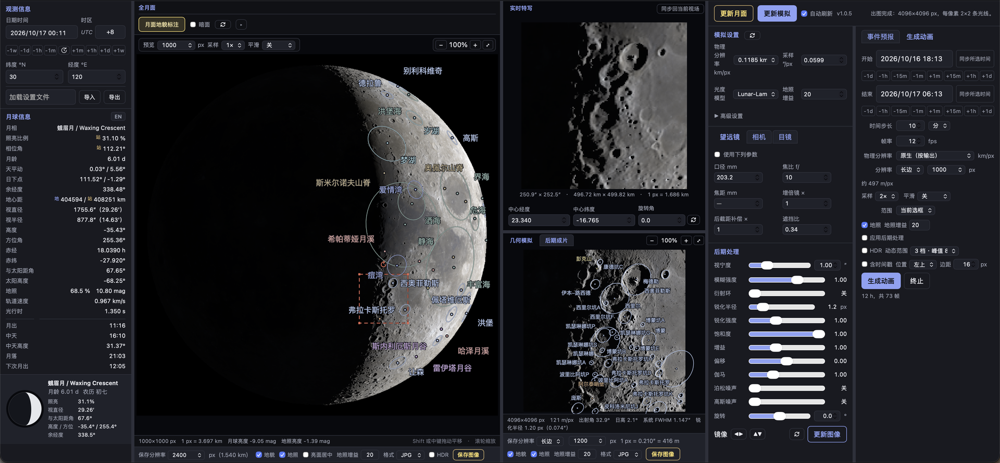

# Tsukikage — 本地月球计算服务

**当前版本 / Version：1.3.3**

**1.3.3 更新**：阴影步进恢复为早期版本的几何采样，保留按相邻样本间距选取地形层级；修复阴影尖端被磨圆。

**1.3.2 更新**：按相邻样本间距选取地形层级，修复中远端的多边形阴影。

**1.3.1 更新**：高级设置新增「并行数」CPU 上限；左栏新增「模拟天空位置」交互窗口。

一套**完全离线**的月球计算内核与观测模拟器：以 JPL DE440/DE441 星历为基础，提供月球的
**位置、月相、升落、天平动、月牙可见性与边缘目标预报**，并能用 NASA SVS 的 LOLA 高程与
LROC 色彩数据**渲染出从地面看到的月面**——含真实地形阴影、明暗界线光照与地照
（earthshine）。算法与判据全部自建，**不使用任何在线天文服务**；按「计算层 / 服务层 /
表现层」分层，对外是稳定的 JSON 数据契约。

---

## 安装

需要 Python 3.9+ 与 git。**不需要下载任何天文数据**——默认的那套 SPICE 内核随仓库发布。

```bash
git clone https://github.com/10deg/tsukikage.git Tsukikage
cd Tsukikage
python3 -m venv .venv
./.venv/bin/python -m pip install --upgrade "setuptools>=68" wheel
./.venv/bin/python -m pip install -e ".[full]"
```

`[full]` 会装上 numpy、spiceypy、timezonefinder 与 matplotlib。后两个是可选的：
没有 timezonefinder 时按经度推算时区，没有 matplotlib 时只有绘图类功能不可用。
`[dev]`（pytest）只对开发这个仓库的人有意义。

确认装好了：

```bash
./.venv/bin/python -c "import moonlib_s; print(moonlib_s.__version__)"
```

> 上面建了虚拟环境，所以下文一律用 `./.venv/bin/python`。没有做可编辑安装时，
> `tools/` 与 `examples/` 下的脚本也会自己把 `src/` 加进 `sys.path`。

## 简单运行

```bash
./.venv/bin/python -m moonlib_s info                          # 内核与历表覆盖范围
./.venv/bin/python -m moonlib_s moon --at 2026-05-25T15:30:00 --language zh
```

```python
import moonlib_s

site = moonlib_s.Observer(lat=30, lon=120)
report = moonlib_s.moon_report(site, "2026-05-25T15:30:00")
print(moonlib_s.reporting.format_moon_report(report))
```

```
  月相 / Phase            : 盈凸月 / Waxing Gibbous
  照明率(地心) / Illum (geo) : 72.0381 %
  月龄 / Moon age         : 8.811 d   (视觉月龄 / visual 9.481 d)
  月面地球直下点 / Sub-Earth point: lon +6.5246°  lat +2.9005°
  月出 / Moonrise         : 2026-05-25 13:33:05 (UTC+08:00)   az 90.31°
  中天 / Transit          : 2026-05-25 19:36:47 (UTC+08:00)   el +58.26°
  月落 / Moonset          : 2026-05-26 01:38:07 (UTC+08:00)   az 266.24°
  下次月出/月落 / Next rise / set: 14:29:30 / 01:38:07
  中天上边缘高度 / Upper limb at transit: +58.515°
```

本地网页：

```bash
./.venv/bin/python web/server.py --port 8765     # 打开 http://127.0.0.1:8765/
```

每个子命令都支持 `--json`，输出与 HTTP API 完全相同的载荷。

## 运行所需的最少文件

| 路径 | 为什么需要 |
|---|---|
| `src/moonlib_s/` | 库本身 |
| `pyproject.toml` | 安装、依赖声明、`moon` 命令行入口 |
| `kernels/` 的 7 个默认内核 | 位置、月相、升落、事件、可见性、天平动；约 51 MB，随仓库发布 |

**要开网页**再加 `web/`。其余目录都不是运行前提：`tools/`、`examples/`、`assets/`
删掉，库、命令行与网页照常工作。**要画月面**另外需要高程栅格，见下一节。

仓库里没有的，是**开发这个库本身才用得到的东西**：回归测试套件、旧实现的只读快照、
一次性探针脚本，以及设计记录。它们留在开发者的工作副本里，不是使用者需要下载的依赖。

---

## 画月面要下载的数据

月面栅格与长时段历表有十几 GB，因此不入版本库。按 [`kernels/README.md`](kernels/README.md)
下载所需的那几个文件即可；脚本会自己找到它们，也可以指到别处：

```bash
export MOONLIB_KERNEL_DIR=/data/spice          # 内核目录（含 naif0012.tls）
export MOONLIB_DEM=/data/LDEM_118m.tif         # 高程：一个文件
export MOONLIB_ALBEDO=/data/lroc_color.exr     # 色彩：一个文件
export MOONLIB_TERRAIN_DIR=/data/moon-rasters  # 或一个目录，两个文件都从这里找
export MOONLIB_CACHE_DIR=/data/moon-cache      # 金字塔缓存写到哪（默认 <仓库>/.cache）
```

**什么都不下载也能跑。** 计算类功能（位置、月相、升落、事件、可见性、天平动、天区图）
需要的内核就在仓库里；只有**画月面**需要高程栅格，缺栅格时渲染会明确告诉你缺哪个文件、
去哪里下，而不是崩溃或悄悄画个球。

最低限度的一套是「`ldem_64.tif` + `lroc_color.exr`」（约 1.4 GB）；要做望远镜特写再补
USGS 的全球 256 像素/度高程：

```bash
./.venv/bin/python tools/fetch_lola_global.py     # 8.5 GB，一次性，之后全离线
```

**无需手动初始化**：第一次渲染时会自动把栅格烘焙成金字塔缓存
（`ldem_64` + EXR 约 350 MB；换成 256 像素/度的全球高程约 3 GB）。

色彩镶嵌优先用线性的 `lroc_color.exr`（自带解码器，无需额外依赖）。若手头只有
`lroc_color_16bit_srgb.tif`，则需要 Pillow（`pip install 'moonlib-s[tiff]'`；装了
matplotlib 就有），两条路径结果一致。

### 高程数据源与切换

月面高程可以放多份，程序按**实测像素宽度**给它们排序（不看文件名），网页面板的
「模拟设置 → 高级设置 → 数据源」里列出本机能用的全部产品，选哪份就用哪份画。

| 产品 | 网格 | 像素 | 体积 | 说明 |
|---|---|---|---|---|
| `ldem_64.tif`（SVS） | 64 ppd | 474 m | 1.0 GB | 最低限度的一套 |
| `Lunar_LRO_LOLA_Global_LDEM_118m_Mar2014.tif`（USGS） | 256 ppd | 118.5 m | 8.5 GB | 长期以来的默认件 |
| `ldem_512.tif`（PDS LOLA GDR V3.0 拼接） | 512 ppd | **59.2 m** | 34 GB | 本仓库脚本可下可拼 |
| `SLDEM2015` 512 ppd（PDS） | 512 ppd | 59.2 m | 34 GB | 熔岩间轨道缝由辉夜号立体补测，**需自行拼接** |

前两份各有一条命令：

```bash
./.venv/bin/python tools/fetch_lola_global.py     # 8.5 GB，USGS 256 ppd
./.venv/bin/python tools/fetch_lola_512.py        # 34 GB，PDS LOLA GDR 512 ppd
```

`fetch_lola_512.py` 逐张下载 16 块瓦片、写进预分配的 `kernels/ldem_512.tif`、删掉瓦片，
所以磁盘峰值是 34 GB 加一块瓦片，而不是 68 GB；中途断了重跑会接着下。

只想把某一处看得更清楚时，不必搬整份产品：高级设置里的「区域高清补片」按**当前选框**
从在线产品里只下那一块（`POST /api/patch`，后台任务带进度），落在 `<cache>/regions/`，
近景会自动改用它。可选的在线产品见 `moonlib_s.online.catalogue()`。

**换了数据源不会重烘焙整月面的金字塔**：10000 px 画幅时一个月面像素是 370 m，
渲染只采样到 474 m 那一层，再细的高程在那里用不上；而近景是从源文件直接裁窗口的，
不需要金字塔。所以选中 59 m 的产品，近景立刻就用上它，整月面仍用已有的那份。

**默认不会自动改用它。** 装好之后程序仍然沿用原来那份已烘焙的高程，直到在「数据源」里
选中它（或有 `MOONLIB_DEM` 指定）；选过之后会记在缓存目录的 `dem_source.json` 里，
下次启动沿用。物理分辨率菜单里那些比当前数据源更细的档位（比如 118 m 档位下的 60 m）
会显示为不可用，换成更细的数据源才会亮起——所以「画面能细到多少」和「菜单让选什么」
永远说的是同一件事。

---

## 界面



左栏是**观测信息**（时刻、站点、时区、月相、升落与天平动）与迷你月相图，下面可以
加载／保存／导出设置；中间是**全月面**（可框选、可叠加按分类着色的地貌名与轮廓）与
**1:1 实时特写**；右栏自左至右是**模拟设置**、**望远镜／相机／目镜**、**后期处理**，
以及**事件预报**与**生成动画**两栏。

---

## 能力一览

| 能力 | 入口 |
|---|---|
| 月球位置、距离、视直径、赤经赤纬、方位高度 | `moonlib_s.moon_state` |
| 月相（地心 + 站心）、月龄、朔望弦搜索与全年历表 | `moon_state().phase`、`moonlib_s.phase_calendar` |
| 月出 / 中天 / 月落（含下次升落与中天上边缘高度） | `moonlib_s.moon_report` |
| 天平动、月面地球直下点与日下点 | `moon_state().libration` |
| 按照明率反查月亮（按视直径排名） | `moonlib_s.find_moons_by_illumination` |
| 极限月牙拍摄窗口与可见性判据（Danjon / Odeh / Yallop） | `moonlib_s.crescent` |
| 边缘／极区目标的天平动可见性预报（53 个目标） | `moonlib_s.libration` |
| 太阳视位置与八字曲线；天区图、月相图与图表 | `moonlib_s.sun`、`moonlib_s.analemma`、`moonlib_s.plotting` |
| 月面地形：高程与反照率采样、金字塔缓存、三维网格导出 | `moonlib_s.terrain` |
| **观测模拟**：按观测点与时刻渲染月面（地形阴影、明暗界线、地照） | `moonlib_s.moonview` |
| **月面特写与自动取景**：按目标真实直径决定视场，并报告地形数据是否够用 | `moonlib_s.moonview.render_region`、`moonlib_s.render_feature` |
| **地貌标注**：10 431 项（中文名覆盖 99.9%），按分类着色并逐类开关，中／英切换 | `moonlib_s.annotations` |
| **与实拍对齐**：衍射（含副镜遮挡）、像素采样、视宁度、噪声、锐化、旋转与后截距补偿 | `moonlib_s.instrument` |
| **动画 → MP4**：H.264，或 10 bit HEVC / HDR10 PQ，可带逐帧时间戳；**HDR 保存**（ISO 21496-1 增益图 JPEG） | `moonlib_s.anim`、`moonlib_s.encode`、`moonlib_s.hdr` |
| **本地网页**：全月面与 1:1 特写、框选与旋转、地貌搜索、设置存成 .conf | `web/server.py` |
| JSON 服务契约 | `moonlib_s.service` |

---

## 自检

仓库自带这几道护栏，都不需要额外下载数据：

```bash
./.venv/bin/python tools/check_layering.py     # 分层与依赖规则
./.venv/bin/python tools/selfcheck.py          # 端到端自检（含一次月面渲染）
node web/test_dom.js && node web/test_page.js && node web/test_projection.js
```

页面的三个 Node 脚本共 422 项，覆盖静态接线、投影与绘制。需要栅格或内核的检查在文件
缺失时**自动跳过**并说明原因，所以没有下载任何栅格也能跑完。

开发用的 pytest 套件（872 项，含数值回归基线与三个帧的 sha256 记录）不随仓库发布；
它的记录写在 `tests/data/` 下。`tools/frame_hashes.py` 读该目录，
`tools/make_legacy_baseline.py` 还要读旧实现的只读快照 `legacy/`——两者都只在开发者的
工作副本里存在，所以这两个工具是给改动本仓库的人用的，不是运行时依赖。

---

## 重要说明

**本项目处于 M2 阶段**：计算内核规范化（M1）已完成，观测模拟（M2）的月面渲染、三维
地形数据接口与本地网页（含动画与 HDR 保存）已落地。月食模拟、交互式月球地图与 APP
属于 M3–M4。

**已知边界**：

- 高度角是几何量，不含逐点大气折射模型；`observational` 升落约定用固定的
  +0.125° 合成阈值。
- Danjon / Odeh / Yallop 判据是已发表的实测模型，作为**参考输出**提供，不参与筛选，
  其适用性随站点与观测者变化。
- `lunar_day_label` 的"农历日"只是月龄近似，与真实农历可能差一天。
- `pck00011.tpc` 与 `de442s.bsp` 随仓库发布但默认不加载（前者与 `pck00010.tpc` 同时
  加载会产生常数歧义）。

**月面数据与渲染的边界**（详见 [`kernels/README.md`](kernels/README.md)）：

- 高程有两档，**用哪一档由盘上的文件决定**，分辨率从文件本身量而不是从名字猜：
  SVS 的 `ldem_64.tif`（64 像素/度，474 m）够画整月面；USGS 的全球 256 像素/度产品
  （118 m）用来做特写。两档都在时取最细的那份，页面能选的最细尺度也跟着它走。
- 只有 64 像素/度那一份时，垂直精度约 1 m，但轨道间隙（1–4 km）由插值填补，
  **有效水平分辨率低于 473.8 m 的像素尺度**；`render_region` 会用 `terrain_limited`
  说明某张特写是否已经越过了数据本身的极限。
- 色彩图是 Hapke 光度**归一化**的相对反射率，不是照片也不是法向反照率；其绝对值经
  人为调整，因此 `normal_albedo` 取「全球平均法向反照率」这一约定（默认 0.136，
  Lane & Irvine 1973）。**地照与日照的比值不受该约定影响**。
- 色彩图 70°N–70°S 之外是单色填补，极区因此偏灰。
- `tone="srgb"`/`"linear"` 是辐射度忠实的「拍摄」结果；由于暗面比亮面暗约 12 个星等，
  单次曝光必然看不到地照。`tone="visual"` 是**目视近似**（自适应 asinh 压缩），属感知
  重建而非辐射度测量。`sunlit` 与 `earthshine` 两个分量始终单独返回，便于自行合成。

**分辨率上限**：默认缓存让月面直径约 2300 px 以内有真实细节；要再往上必须重建更细的
缓存（`--detail 0 --albedo-detail 0`，约 3.5 GB）。数据本身的极限是月面直径约 7300 px
——再大只是插值放大。

**局部特写需要更高分辨率的高程。** `ldem_64` 的 474 m/px 在特写下明显不够：
`render_region` 会报告 `terrain_limited`，为真时说明输出像素已小于地形像素、图像只是
在插值放大。装上 USGS 的全球高程后这一切自动解决：

```bash
./.venv/bin/python tools/fetch_lola_global.py     # 8.5 GB，一次性，之后全离线
# 或者只取需要的那一块（range 请求，约 60 MB / 1 分钟）：
./.venv/bin/python tools/fetch_lola_global.py --name clavius --lat -66.5 -50.5 --lon -29 1
```

`render_region` 会自己发现它、按需从本地文件里裁出画幅所需的那一小块，于是任意目标
都能拿到 118 m/px，无需联网。换一份自己的 DEM 也可以：
`export MOONLIB_DEM=/path/to/dem.tif`，单位按文件名识别（见 `moonlib_s.terrain._dem_scale`）。

---

Tsukikage 以 [MIT 许可](LICENSE)发布。数据出处与致谢见
[`ACKNOWLEDGEMENTS.md`](ACKNOWLEDGEMENTS.md)；内核文件清单、出处 URL 与校验方式见
[`kernels/README.md`](kernels/README.md)。
