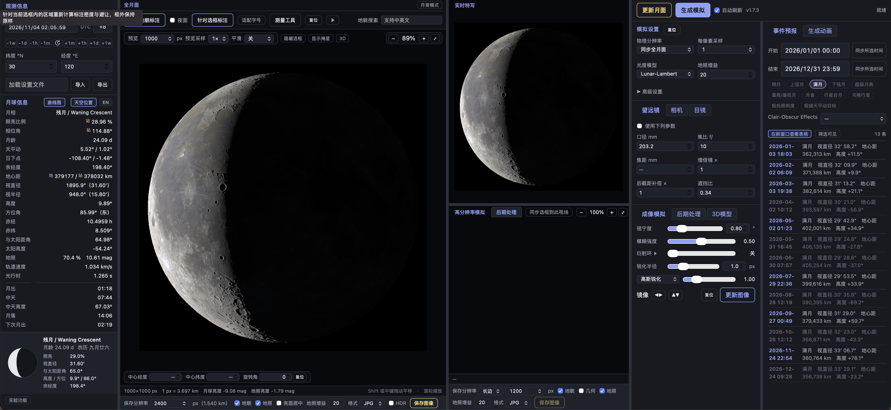
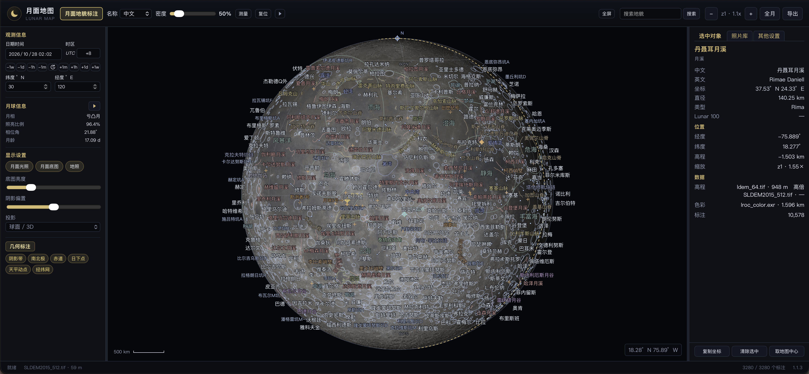

# Tsukikage

基于**离线的本地计算内核**的月亮观测信息计算、月面光照模拟与月面地图服务工具。

## 当前版本：

光照模拟 1.7.3  
月面地图 1.1.3

---

## 主要功能：

1. 基于 JPL DE440/DE441 星历，实现离线的月球位置、相位、升落、天平动与事件预报等观测信息计算。
2. 可使用 NASA SVS 的 LOLA / KAGUYA SLDEM 等高程数据，结合 NASA LROC 的彩色纹理，模拟渲染从地球上看到的月面光影。
3. 构建带有真实光照效果的高分辨率月面地图服务，支持月面地貌检索、个人月面摄影作品的叠加显示（该功能需结合经 [MoonLabeler](https://github.com/Fluorine7/MoonLabeler) 识别后的配置文件使用）。

前两项可通过命令行实现绝大部分功能。

这套代码目前对CPU、内存读取性能的要求较高，尤其是月面地图服务。也许哪天能重写底层做些优化。（画饼ing…）

---

## 安装

需要 Python 3.9+ 与 git

```bash
git clone https://github.com/10deg/tsukikage.git Tsukikage
cd Tsukikage
python3 -m venv .venv
./.venv/bin/python -m pip install --upgrade "setuptools>=68" wheel
./.venv/bin/python -m pip install -e ".[full]"
```

`[full]` 会装上 numpy、spiceypy、timezonefinder 与 matplotlib。  
后两个是可选的，极致节省代码体积时可考虑去除：

- 没有 timezonefinder 时按经度推算时区；
- 没有 matplotlib 时绘图类功能不可用。

### 验证安装成功：

```bash
./.venv/bin/python -c "import moonlib; print(moonlib.__version__)"
```

注：
上面建了虚拟环境，所以下文一律用 `./.venv/bin/python`。  
没有做可编辑安装时， `tools/` 与 `examples/` 下的脚本也会自己把 `src/` 加进 `sys.path`。

## 运行前注意

- 要实现**月面光照模拟**和**月面地图**功能，还需要[**下载两个数据文件**](#模拟月面需要的高程数据)，否则只能实现[最基础的计算功能](#主要功能)，月面地图服务则会用平坦高程启动，地貌、坐标、照片、蒙版和几何标注均可用，但底图没有地形起伏与反照率。
- 要实现**高分辨率月面光照模拟**还需要额外下载[高分辨率的高程栅格数据](#模拟月面需要的高程数据)。

## 简单运行

**打开光照模拟**：

```bash
./.venv/bin/python web/server.py --port 8765     # 打开 http://127.0.0.1:8765/
```

第一次渲染时会自动把`kernels/`目录下的[栅格](#模拟月面需要的高程数据)烘焙成金字塔缓存

**打开月面地图**：

```bash
./.venv/bin/python web/map_server.py --port 8766 # 打开 http://127.0.0.1:8766/
```

## 命令行使用举例：

```bash
./.venv/bin/python -m moonlib info                          # 内核与历表覆盖范围
./.venv/bin/python -m moonlib moon --at 2026-05-25T15:30:00 --language zh
./.venv/bin/python -m moonlib sunpoint --moon-lon 0 --moon-lat 0 --lat 30 --lon 120 --at 2026-05-25T15:30:00 --language zh
```

Python中import使用：

```python
import moonlib

site = moonlib.Observer(lat=30, lon=120)
report = moonlib.moon_report(site, "2026-05-25T15:30:00")
print(moonlib.reporting.format_moon_report(report))
```

输出：

```
  月相 / Phase            : 盈凸月 / Waxing Gibbous
  照明率(地心) / Illum (geo) : 72.0381 %
  月龄 / Moon age         : 8.811 d   (视觉月龄 / visual 9.481 d)
  月面地球直下点 / Sub-Earth point: lon +6.5246°  lat +2.9005°
  月出 / Moonrise         : 2026-05-25 13:33:05 (UTC+08:00)   az 90.31°
  中天 / Transit          : 2026-05-25 19:36:47 (UTC+08:00)   el +58.26°
  月落 / Moonset          : 2026-05-26 01:38:07 (UTC+08:00)   az 266.24°
  下次月出/月落 / Next rise / set: 14:29:30 / 01:38:07
  中天上边缘高度 / Upper limb at transit: +58.515°
```

## 本地服务方式：

```bash
./.venv/bin/python -m pip install -e ".[service]"
./.venv/bin/python -m service --service both --data-dir /path/to/kernels
```

地图服务与网页客户端共用本地的内核、地貌库和高程数据，但分别监听端口，可以同时打开。
启动后会在本机 `127.0.0.1` 上开一个或多个 HTTP 服务，并打开系统默认浏览器。

## 运行所需的最少文件

| 路径 | 功能 |
|---|---|
| `src/moonlib/` | 库本身 |
| `pyproject.toml` | 安装、依赖声明、`moon` 命令行入口 |
| `kernels/` 的 7 个默认内核 | 位置、月相、升落、事件、可见性、天平动；约 51 MB，打包时作为 exe 同目录附件 |
| `web/` | 非运行必需，网页客户端与月面地图服务 |
| `service/`、`packaging/` | 非运行必需，浏览器服务版与打包 |
| `tools/` | 非运行必需 |
| `examples/` | 非运行必需 |
| `assets/` | 非运行必需 |

---

除此之外，`kernels/`中还需要两个[基本数据文件](#满足最低限度使用的一套数据是) 方可实现完整功能，见下文。

## 模拟月面需要的高程数据

月面光照模拟所需的数据文件，以及长时段历表（DE441）体积较大，因此未上传。当前`kernels/`中仅包含月球计算内核所需的基本数据，**无法直接使用光照模拟功能**。需要**手动下载**必要的高程、色彩纹理数据等才能实现完整功能。

### 满足最低限度使用的一套数据是

1 份转换为 `置换贴图（Displacement map）` 的DEM 数据文件 + 1 份 `颜色贴图（Color Map）` 文件

可在 [NASA SVS CGI Moon Kit](https://svs.gsfc.nasa.gov/4720) 下载：
选择`Color` 与 `Displacement`栏提供的文件，不同文件对应不同的分辨率。

推荐使用「`ldem_64.tif` + `lroc_color.exr`」（约 1.06 GB + 990 MB），分辨率为 474 m/px，对应全月面像素变边长约 2300 px 。 此分辨率不足以用于高分辨率月面特写。

第一次渲染时会自动把栅格烘焙成金字塔缓存（`ldem_64` + `lroc_color.exr` 换成 256 像素/度的全球高程约 3 GB）。

颜色贴图中：

- `lroc_color.exr`为线性，自带解码器，无需额外依赖即可使用。
- `lroc_color_16bit_srgb.tif`则需要有 Pillow（`pip install -e '.[tiff]'`；装了matplotlib 就有），两条路径结果一致。

软件会自动识别高程数据，也可手动指定：

```bash
export MOONLIB_KERNEL_DIR=/data/spice          # 内核目录
export MOONLIB_DEM=/data/ldem_64.tif         # 高程：一个文件
export MOONLIB_ALBEDO=/data/lroc_color.exr     # 色彩：一个文件
export MOONLIB_TERRAIN_DIR=/data/moon-rasters  # 或一个目录，两个文件都从这里找
export MOONLIB_CACHE_DIR=/data/moon-cache      # 金字塔缓存写到哪（默认 <仓库>/.cache）
```

### 要实现高分辨率光照模拟

NASA SVS CGI Moon Kit 提供的 **64 px/deg** 数据已不够用，需要下载更高分辨率的数据。

可选的更高分辨率数据源有：

| 产品 | 网格 | 分辨率/px | 体积 | 发布年份 | 说明 |
|---|---|---|---|---|---|
| `ldem_64.tif` | 64 ppd | 474 m | 1.0 GB | 2019 | 最低限度的一套，在 **NASA SVS CGI Moon Kit** [下载](https://svs.gsfc.nasa.gov/4720)  |
| `Lunar_LRO_LOLA_Global_LDEM_118m_Mar2014.tif` | 256 ppd | 118.5 m | 8.5 GB | 2014 | 在 **USGS** [下载](https://astrogeology.usgs.gov/search/map/moon_lro_lola_dem_118m)，下文提供脚本自动下载 |
| `ldem_512.tif` | 512 ppd | **59.2 m** | 34 GB | 2017 | PDS LOLA GDR V3.0 拼接，原始数据分块来自 [PDS](https://pds-geosciences.wustl.edu/lro/lro-l-lola-3-rdr-v1/lrolol_1xxx/data/lola_gdr/cylindrical/img/)，下文提供脚本自动下载与拼接 |
| `SLDEM2015_512.tif` | 512 ppd | **59.2 m** | 34 GB | 2015 | ±60° 内由辉夜号（Kaguya） TC 立体填缝，极区用上面的 LOLA 512 数据补全，原始数据来自[LOLA PDS Data Node](https://imbrium.mit.edu/DATA/SLDEM2015/TILES/FLOAT_IMG/)，下文提供脚本自动下载与拼接 |

更高分辨率的数据（1024 pdd），或全球覆盖不全，或来自于 512 ppd 数据的插值，且数据体积庞大（超过100 GB）故不再推荐使用。

**256 px/deg** 数据可选择 [USGS](https://astrogeology.usgs.gov/search/map/moon_lro_lola_dem_118m) 的 LRO LOLA 全球高程数据 `Lunar_LRO_LOLA_Global_LDEM_118m_Mar2014.tif`， `tools/`目录中提供了一个下载脚本：

```bash
./.venv/bin/python tools/fetch_lola_global.py
```

更高分辨率的 **512 px/deg** 高程数据，可选择 USGS 的 LRO LOLA 全球高程数据 `ldem_512.tif`，该数据需要分块下载，`tools/`目录中提供了一个下载脚本实现自动下载与拼接转换：

```bash
./.venv/bin/python tools/fetch_lola_512.py
```

逐张下载 16 块瓦片、写进预分配的 `kernels/ldem_512.tif`、删掉瓦片，拼接完共约 34 GB。支持断点续传。

但我更推荐使用 `SLDEM2015+LOLA`方案，在 ±60° 内由辉夜号（Kaguya） TC 立体填缝，极区用上面的 LOLA 512 数据补全：

```bash
./.venv/bin/python tools/fetch_sldem_512.py
```

逐张下载 32 块 ±60° 瓦片（约 45 GB），因 SLDEM2015 没有 512 ppd 的极区产品，所以 ±60–90° 从本机已有的 `ldem_512.tif` 直接复制。若本地没有`ldem_512.tif`，则会下载依赖的 LOLA 数据再进行合成。支持断点续传。

如有临时需求，只想在某一处实现高分辨率模拟时，也可不下载整份产品。高级设置里的「区域高清补片」按**当前选框**可从在线产品匹配所需的高程数据（`POST /api/patch`，开启后台任务）。

### 总结：

**推荐组合：`ldem_64.tif` + `SLDEM2015_512.tif`。**  
`ldem_64` 用于整月面金字塔，启动快、占用小；`SLDEM2015_512` 用于高分辨率光照模拟，是目前能获取的质量最好（除高纬度区域）的高程数据。

---

### 高程数据源与切换

月面高程数据可以存放多份，程序会自动**实测像素宽度**，在网页面板的「模拟设置 → 高级设置 → 数据源」里列出识别到的全部产品。

切换数据源不会重新烘焙本地整月面的金字塔缓存，若想重新烘焙整月面金字塔，可使用`光照模拟网页`「模拟设置 → 高级设置」和`月面地图`「其他设置」里的「重新构建金字塔」。虽然代码支持，但不推荐直接使用超高分辨率的数据烘焙金字塔，不仅耗时，缓存体积也相当大。

月面颜色需要在本地建立缓存，以方便快速渲染。默认使用 `albedo_detail=2`（19 px/deg，约 1.6 km/px，约 2.8 GB），这是不额外占盘的默认值。想要更细的颜色，可以重新烘焙高精度缓存：

```bash
./.venv/bin/python -m moonlib terrain --bake --albedo-detail 0
```

`albedo_detail=0` 是源图完整的 76 px/deg（约 0.4 km/px），缓存约 **5.4 GB**；
网页服务启动时会自动选用本地已经存在的最高精度颜色缓存。

---

## 界面

### 光照模拟页面



### 月面地图页面



---

## 月面地图服务

地图服务是独立于模拟器的第二个本地页面（默认 `http://127.0.0.1:8766/`）。它直接读取同一份
DEM、反照率、地貌库和月球照片工程，不需要再额外构建新数据文件。

---

## 重要说明

**已知边界**：

- 高度角是几何量，不含逐点大气折射模型；`observational` 升落约定用固定的
  +0.125° 合成阈值。
- Danjon / Odeh / Yallop 判据是已发表的实测模型，作为**参考输出**提供，不参与筛选，
  其适用性随站点与观测者变化。
- 网页与 `chinese_lunar_date` 显示的是**按 GB/T 33661 算出的真实农历**（新月定朔、
  冬至定月、无中气置闰，时间为北京时间）；`lunar_day_label` 保留为旧接口，仍是月龄
  近似，与真实农历可能差一天，新代码不要再用它。

**月面数据与渲染的边界**（详见 [`kernels/README.md`](kernels/README.md)）：

- 色彩图是 Hapke 光度**归一化**的相对反射率，不是照片也不是法向反照率；其绝对值经
  人为调整，因此 `normal_albedo` 取「全球平均法向反照率」这一约定（默认 0.136，
  Lane & Irvine 1973）。**地照与日照的比值不受该约定影响**。地球/月球反照率的
  具体数值范围与文献引用见 [`ACKNOWLEDGEMENTS.md`](ACKNOWLEDGEMENTS.md) 的
  「反照率与光度参数」一节。
- 色彩图 70°N–70°S 之外是单色填补，极区因此偏灰。
- `tone="srgb"`/`"linear"` 是辐射度忠实的「拍摄」结果；由于暗面比亮面暗约 12 个星等，
  单次曝光必然看不到地照。`tone="visual"` 是**目视近似**（自适应 asinh 压缩），属感知
  重建而非辐射度测量。`sunlit` 与 `earthshine` 两个分量始终单独返回，便于自行合成。
- **月背视角**（`viewpoint="far_side"`）的相机是真实地球地心的月心对称点，取地心距；
  月背的日照是真实的，**地照来自同一颗假想地球**（相位与真实地球互补），不是真实地球
  的光穿透月球。满月时月背是夜面，只有假想地照；新月时月背全亮。
- **3D 地形切片**（`selection_tile` / 网页「3D模型」）在局部切平面里按**地面公里**建网格，
  不按经纬度：极区不会因经度线收敛而东西向压扁。顶面是地形，四周竖直、底面削平；
  STL 是毫米、z 向上的二进制文件。选框越过月缘会被拒绝；模型上限 768 采样。
- **整月面分辨率上限**：默认缓存让月面直径约 2300 px 以内有真实细节；要再往上必须重建更细的
缓存（`--detail 0 --albedo-detail 0`，约 3.5 GB）。数据本身的极限是月面直径约 7300 px
——再大只是插值放大。

---

Tsukikage 以 [MIT 许可](LICENSE)发布。数据出处与致谢见
[`ACKNOWLEDGEMENTS.md`](ACKNOWLEDGEMENTS.md)；内核文件清单、出处 URL 与校验方式见
[`kernels/README.md`](kernels/README.md)。
